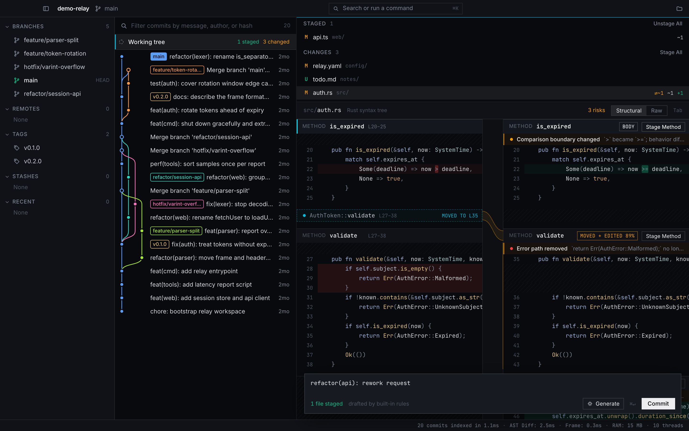
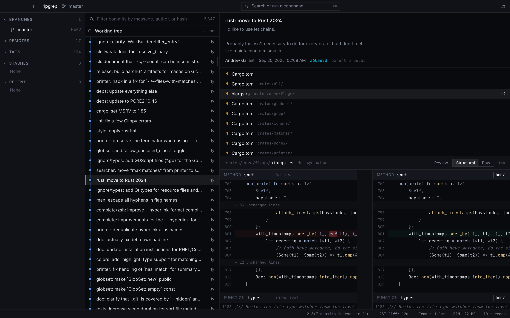
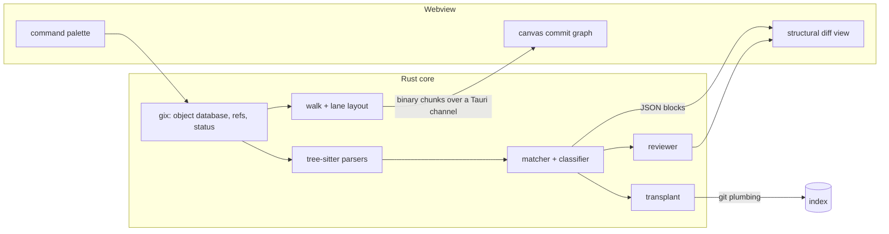

# Graft

A native Git client that diffs syntax trees instead of lines.

Line diffs punish refactoring: move a function and you get forty red lines and forty green ones, with the one real edit buried somewhere inside. Graft parses both sides of every changed file with tree-sitter, pairs declarations across the whole changeset, and shows what actually happened: this function moved, that one moved and changed 11% of its tokens, this signature gained a parameter.



The screenshot shows the working tree of the built-in demo repository. `is_expired` has a one-token body edit, `validate` moved below two other methods and lost an error path, and `remaining_ttl` is new. Each can be staged on its own.

## What it does

- **Structural diff engine.** Functions, methods, types, and impl blocks are matched by normalized syntax-tree hash, then by name, then by token similarity. Each change is classified as moved, moved and edited, signature changed, body changed, added, or deleted. Whitespace and comment edits are not changes.
- **Moves across files.** Matching runs over the whole changeset, so a function cut from `lexer.rs` and pasted into `parser.rs` is one move, not a deletion and an addition.
- **Aligned side-by-side view.** A moved declaration is shown with its old and new text next to each other, however far it travelled, with only the changed tokens highlighted. A ribbon connects the block to a marker at its former position.
- **Function-level staging.** Stage or unstage one declaration, including a moved one, without touching the rest of the file.
- **Commit graph on a canvas.** The history streams in as binary chunks and is painted on a single virtualized canvas, so a repository with 100,000 commits is scrollable while it is still loading.
- **Command palette and keyboard map.** `Cmd+K` searches commits, branches, tags, changed files, and actions.
- **Commit drafting and risk audit that work offline.** Built-in rules draft a Conventional Commit message from the structural summary and flag removed error paths, new aborts, flipped comparison boundaries, and breaking signature changes. A language model can be plugged in to add its own findings; it is never required.
- **Line diff fallback.** Formats without a grammar (Markdown, JSON, YAML, plain text) get a Myers line diff with word-level highlights. `Tab` switches any file to the raw unified view.

Grammars are bundled for Rust, TypeScript, TSX, JavaScript, Python, and Go.



A commit from the ripgrep history: a 58-line method whose only change is one removed `ref` keyword.

## Getting started

### Prerequisites

- A recent stable Rust toolchain (developed with 1.100)
- Node.js 22 or newer
- Git 2.30 or newer on your `PATH`
- The [Tauri v2 system dependencies](https://v2.tauri.app/start/prerequisites/) for your platform

### Run

```bash
npm install
npm run tauri dev
```

On the start screen, choose **Open Built-In Refactor Demo Repo**. Graft generates a small multi-language repository with 20 commits on five branches, plus staged, unstaged, and untracked work, and opens it. Every structural change kind appears somewhere in its history.

To open your own repository, use `Cmd+O`, drop a folder on the window, or pass a path on the command line:

```bash
npx tauri dev -- -- /path/to/repository
```

### Build

```bash
npm run tauri build
```

The bundle is written to `src-tauri/target/release/bundle/`.

### Test

```bash
cd src-tauri
cargo test          # 35 tests; needs git on PATH
cd .. && npx tsc --noEmit
```

## Keyboard

| Key | Action |
| --- | --- |
| `Cmd+K` | Command palette |
| `Cmd+O` | Open a repository |
| `Cmd+B` | Toggle the sidebar |
| `J` / `K` or arrows | Next / previous commit, or structural change when the inspector has focus |
| `H` / `L` or arrows | Focus the graph / the inspector |
| `Space` | Stage or unstage the active declaration, or the open file |
| `Tab` | Switch between the structural diff and the raw unified diff |
| `Cmd+Shift+R` | Run the risk audit on the current changeset |
| `Cmd+Enter` | Commit, from the message box |
| `/` | Filter commits |
| `C` | Jump to the commit message box |

`Ctrl` replaces `Cmd` on Windows and Linux.

## Language model (optional)

With no configuration, commit drafts and risk findings come from built-in rules and nothing leaves your machine. To add a model, use **Configure AI Provider** in the palette or set environment variables before launching:

| Variable | Meaning |
| --- | --- |
| `GRAFT_AI_PROVIDER` | `anthropic`, `openai`, or `ollama` |
| `GRAFT_AI_MODEL` | Model name. Defaults to `claude-opus-5-5` for Anthropic; required for the others |
| `GRAFT_AI_BASE_URL` | Override the endpoint, for proxies and OpenAI-compatible servers |
| `GRAFT_AI_API_KEY` | API key. `ANTHROPIC_API_KEY` and `OPENAI_API_KEY` are also read |

Only the structural summary is sent: one line per changed declaration and an excerpt of the lines that differ. Unchanged code is never included. If a request fails or the model declines, Graft falls back to the built-in rules and says why. Settings saved in the app are stored in the app configuration directory with owner-only permissions.

## Architecture



### Layout

```
src-tauri/src/
  git/         repo.rs       refs, HEAD, stashes, commit details (gix)
               walk.rs       newest-first traversal, one decode per commit
               graph.rs      lane assignment and the streaming pipeline
               wire.rs       binary chunk encoding
               search.rs     row index for commit search
               status.rs     HEAD vs index vs working tree
               index.rs      staging, commit, checkout, cherry-pick (git CLI)
  ast_diff/    parser.rs     tree-sitter walk: tokens and declarations
               language.rs   per-grammar declaration rules
               matcher.rs    pairing passes and classification
               moves.rs      which pairs count as moved
               lines.rs      Myers alignment and token-level highlights
               render.rs     display blocks for one file
               stage.rs      rewrite one declaration inside a file
  ai/          summary.rs    structural summary for a model
               heuristics.rs offline risk rules
               drafting.rs   offline commit message
               client.rs     Anthropic and OpenAI-compatible HTTP
  demo/        sandbox.rs    demo repository generator
  commands.rs  commands/     Tauri IPC surface
src/
  components/graph/      canvas renderer, edge routing, filter bar
  components/diff/       structural and raw diff views, move ribbons
  components/palette/    command palette and provider settings
  components/inspector/  file list, toolbar, commit box
  store/                 Zustand stores
  lib/graphModel.ts      zero-copy views over the binary chunks
```

No Rust or TypeScript file in the project is longer than 220 lines.

### Commit graph

The walk pops commits from a priority queue ordered by commit time and decodes each commit object once. When the repository has a commit-graph file, topology comes from the memory map instead and author and summary are decoded afterwards on all cores.

Lane assignment is inherently sequential, since a row depends on the lanes left open above it, so it runs concurrently with that decode rather than being parallelized itself. A lane is reserved for the parent a child is waiting on and stays put until the parent appears, which keeps first-parent chains straight. When several lanes wait on the same commit it takes the leftmost and the others bend into it.

History is sent in chunks of 2,048 rows over a Tauri channel as raw bytes. Every section is 4-byte aligned, so the webview wraps each chunk in `Uint32Array` views without copying:

| Section | Size | Content |
| --- | --- | --- |
| header | 12 x u32 | magic, first row, counts, flags, lane count, elapsed time |
| rows | 2 x u32 per row | lane, color, parent count; commit time |
| string ends | 2 x u32 per row | cumulative offsets of summary and author |
| edge ends | u32 per row + 1 | prefix offsets, bucketed by the row an edge ends on |
| edges | 2 x u32 per edge | upper row; travel lane and color |
| open edges | 2 x u32 per edge | edges whose parent has not been reached yet |
| ref marks | 2 x u32 per mark | row and ref index |
| oids | 20 bytes per row | commit ids |
| strings | bytes | UTF-8 summaries and authors, decoded only for visible rows |

Edges are bucketed by the row they end on, and every chunk carries the edges still open at its end. To paint rows `a..b` the renderer scans the buckets from `a` to the end of the chunk holding `b` and adds that chunk's open edges, so the work per frame is bounded by one chunk whatever the size of the history. Rails are batched into one path per lane color.

Scrolling is driven by wheel deltas instead of a native scroller. There is no spacer element to hit browser height limits, and each frame is painted from the same state it scrolled.

### Structural diff

1. **Parse.** Each side of each file is parsed in parallel. One iterative tree walk produces a token list (with syntax class, grammar symbol, and tree depth) and the declarations, including nesting: methods belong to their class or impl block.
2. **Fingerprint.** A declaration's hash covers the symbol, relative depth, and text of every token except comments. Hashing depth means a statement moved out of an `if` block in Python changes the hash even though no token did. Signature and body are hashed separately.
3. **Pair.** Four passes, strongest evidence first: same file and qualified name; identical hash anywhere in the changeset; same name elsewhere with at least 40% token overlap; then body similarity of at least 60% for renames. Pairing a container pairs its members by name. A shared-token count gives an upper bound on similarity, so unrelated candidates are rejected without running a diff.
4. **Classify.** A pair has moved if it changed file or container, or if it fell out of the longest run of siblings that kept their relative order. That last rule is why a function pushed down by new code above it is not reported as moved.
5. **Render.** For the file on screen, each change becomes a block of aligned rows. Lines are aligned with Myers, comparing trimmed text, and changed lines get a second Myers pass over their tokens. Code outside any declaration is diffed as line hunks.

### Function-level staging

Staging a declaration diffs the index version of the file against the working tree version, finds the selected change, and rewrites only that span of the index text. A new or moved declaration is inserted after the nearest preceding sibling that both versions share in the same order. The result is written with `git hash-object` and `git update-index`; the working tree is not touched. Unstaging does the same from `HEAD` into the index.

One test stages every declaration of a file one at a time and asserts that the index ends up byte-identical to the working tree.

Reads go through gix in-process. Mutations (staging, commit, checkout, cherry-pick) are delegated to the `git` binary so hooks, signing, and index extensions behave exactly as they do on the command line.

## Benchmarks

Measured on an Apple M1 Max (10 cores, 64 GB), macOS 27.0, release build. Each figure is the median of five runs unless noted.

### Commit graph ingestion

`cargo run --release --example ingest -- <repository>`

| Repository | Commits | Commit-graph file | First chunk | Full graph | Payload |
| --- | ---: | --- | ---: | ---: | ---: |
| git/git | 86,340 | no | 16.5 ms | 461 ms | 9.1 MB |
| git/git | 86,340 | yes | 4.2 ms | 133 ms | 9.1 MB |
| synthetic, 5,740 merges | 150,000 | no | 8.3 ms | 502 ms | 13.3 MB |
| synthetic, 5,740 merges | 150,000 | yes | 3.5 ms | 177 ms | 13.3 MB |

The first chunk is what makes the window interactive. Without a commit-graph file the walk is bound by decompressing commit objects on one thread; `git commit-graph write --reachable` removes that cost. A substring search over all 150,000 summaries and authors takes 1.4 ms.

### Structural diff

`cargo run --release --example history -- <repository> <commits>`

Every non-merge commit in the ripgrep history (at `fdf7d95`), parsing both sides of every changed file and matching the changeset:

| Commits | File pairs | Source parsed | Median | p95 | Slowest |
| ---: | ---: | ---: | ---: | ---: | ---: |
| 2,173 | 5,149 | 220.5 MB | 0.36 ms | 15.3 ms | 69.8 ms |

The slowest commit touches 40 files and 2.4 MB of source. Across that history the engine reported 73 pure moves and 281 moved-and-edited declarations that a line diff would have shown as unrelated deletions and additions.

### Rendering

With the 150,000-commit repository loaded, painting a frame of the graph takes 0.6 to 1.7 ms at 2x device pixel ratio, measured in Chromium against the same frontend code. The status bar shows the live figure. That is well inside the 8.3 ms budget of a 120 Hz display, but the actual refresh rate is decided by the system webview, which on macOS commonly caps animation callbacks at 60 Hz.

## Limitations

- Fetch, pull, push, rebase, and merge are not implemented. Stashes are listed but cannot be applied.
- Staging works per file and per declaration, not per line hunk. An in-place edit to a class or impl header cannot be staged separately from its members.
- A cherry-pick that conflicts is aborted and reported rather than left for manual resolution.
- SHA-256 repositories are not supported.
- Files that are binary or larger than 1 MB are listed but not diffed, and a changeset is analyzed up to its first 400 files.
- The walk orders by commit time. A commit whose parent carries a later timestamp is still drawn correctly, but its edge runs upward.

## License

MIT. See [LICENSE](LICENSE).
