<p align="center">
  
</p>

<h1 align="center">Graft</h1>

<p align="center">
  <strong>A fast desktop Git client that diffs code structure, not lines.</strong><br>
  Rust, Tauri 2, tree-sitter, and React. Developed and tested on macOS.
</p>

<p align="center">
  
</p>

## In 30 seconds

- **It understands refactors.** When a function moves, Graft says *moved*, not "40 lines deleted, 40 lines added". When it moves and changes, only the change is highlighted.
- **It is fast.** The whole history of git/git (86,340 commits) is laid out in **132 ms**, 8.6 times faster than `git log --graph`. A diff takes **0.36 ms** at the median.
- **It covers everyday Git.** Fetch, pull, push, merge, rebase, cherry-pick, revert, reset, stash, branches, tags, blame, and conflict resolution, plus staging by file, function, hunk, or single line.

| | |
| --- | --- |
| **Commits laid out per second** | about 650,000 (git/git, full history) |
| **First rows on screen** | 4 ms after opening a repository |
| **Structural diff, median / p95** | 0.36 ms / 15 ms over 2,173 ripgrep commits |
| **Graph frame paint** | 0.6 to 1.7 ms with 150,000 commits loaded |
| **App size** | 15 MB app, 7 MB disk image |
| **Codebase** | 5,300 lines of Rust, 4,900 of TypeScript, 58 integration tests |

## Why a structural diff

Here is the same refactor, moving frame and header decoding out of a lexer into a new file, in both views.

| Line diff: every line looks new | Graft: three moves, one moved function with an edit, one new constant |
| --- | --- |
| 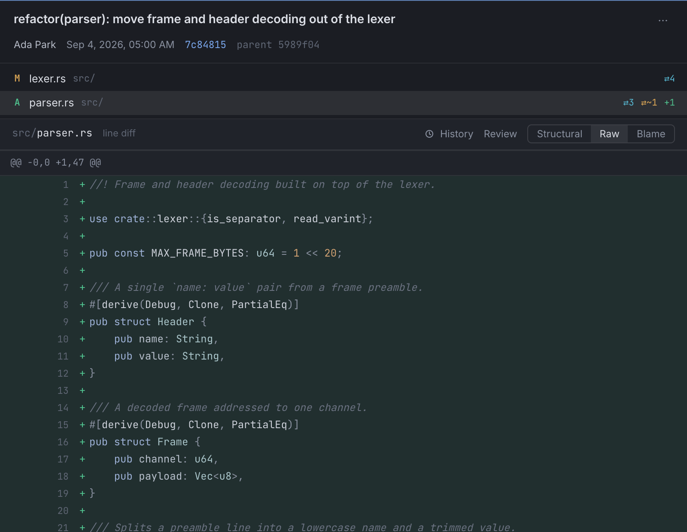 | 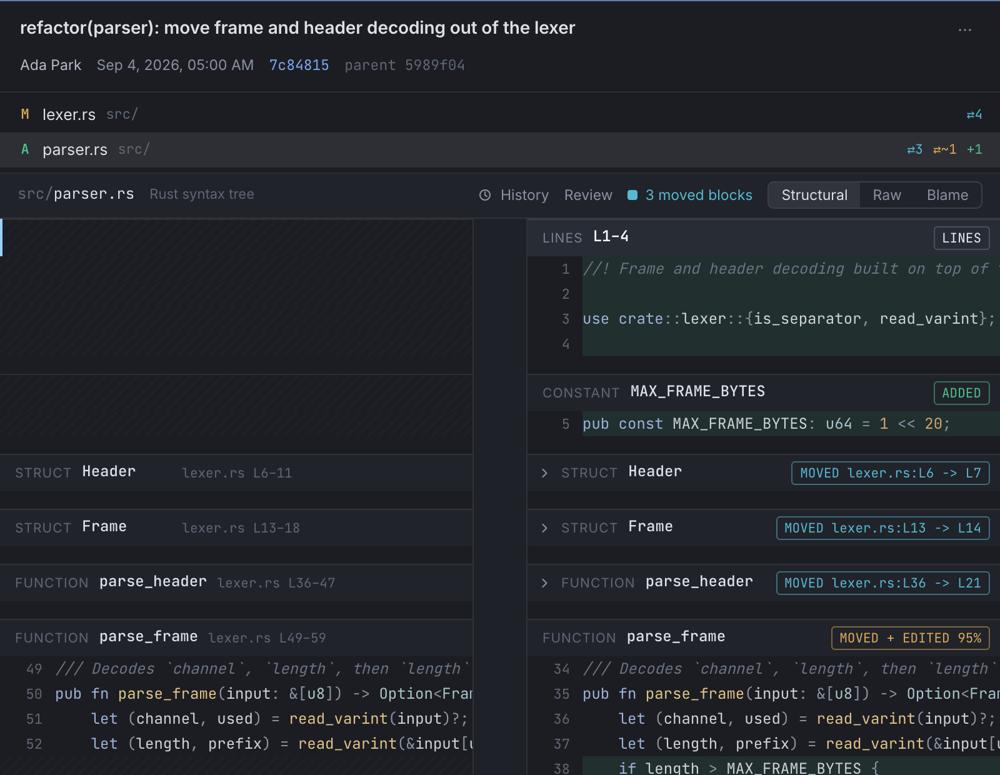 |

Graft parses both versions of every changed file, pairs up functions, methods, and types across the whole commit, and classifies each pair: moved, moved and edited, signature changed, body changed, added, or deleted. Whitespace and comment edits are not changes.

On real refactors this removes most of what a reviewer has to read. Measured on the ripgrep repository:

<picture>
  <source media="(prefers-color-scheme: dark)" srcset="docs/charts/review-lines-dark.svg">
  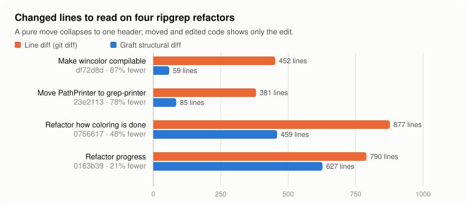
</picture>

On ordinary commits both views show about the same amount; the difference is in commits that move code. Across ripgrep's full history the engine found 73 pure moves and 281 moved-and-edited declarations.

<details>
<summary>Example from ripgrep: a 58-line method whose only change is one removed <code>ref</code> keyword</summary>


</details>

## Features

| Stage single lines or whole hunks | Blame, with the age of each line |
| --- | --- |
| 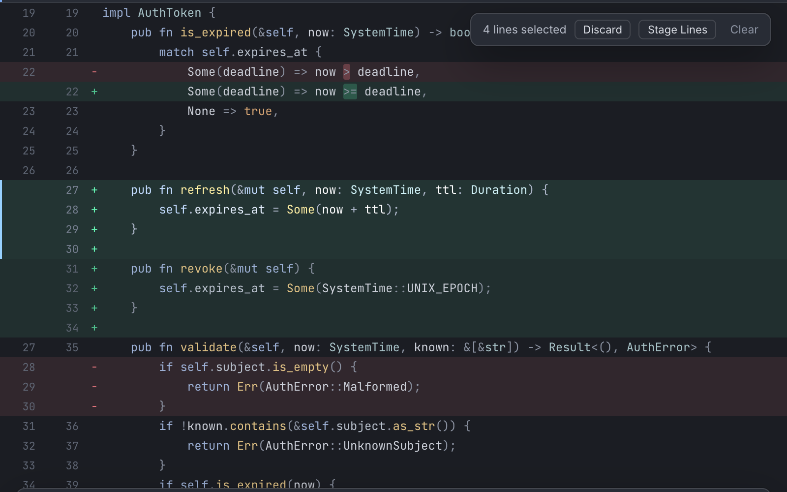 | 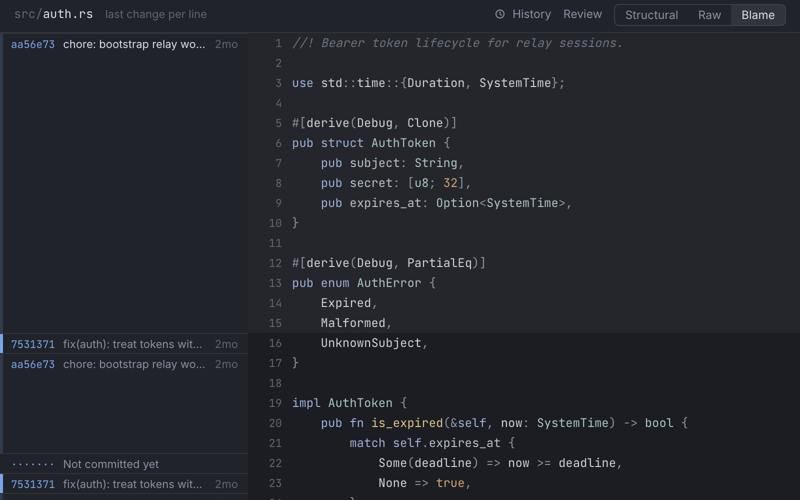 |
| **Resolve conflicts without leaving the app** | **Every Git action one right-click away** |
| 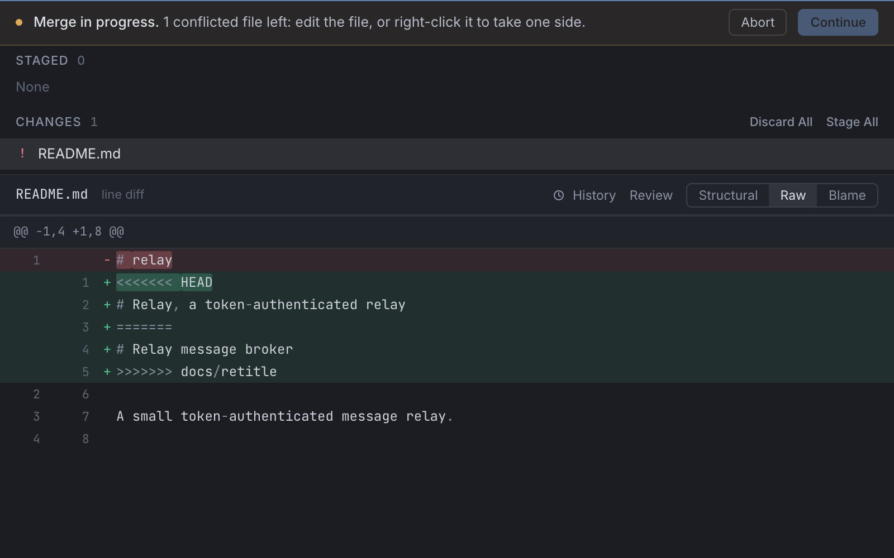 | 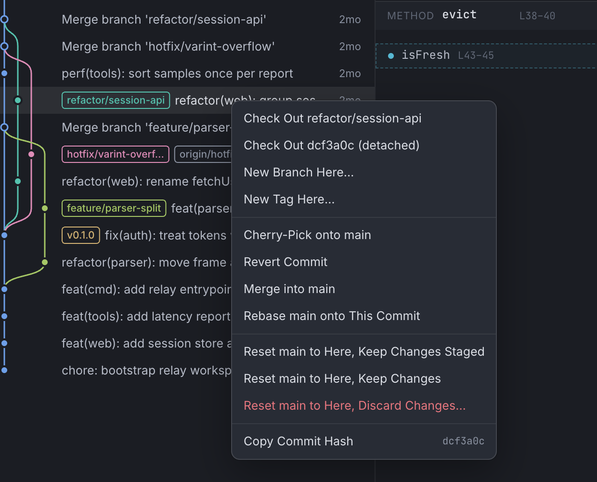 |

**Reviewing**
- Structural diff for Rust, TypeScript, TSX, JavaScript, Python, and Go; a line diff with word highlights for everything else.
- Moves are tracked across files: code cut from `lexer.rs` and pasted into `parser.rs` is one move. A ribbon links each moved block to where it came from.
- Blame (`B`) and file history, which narrows the graph to the commits that touched the open file.
- Offline risk audit (`Cmd+Shift+R`): flags removed error paths, new panics, flipped comparisons, and breaking signature changes. An AI model can be added, but is never required.

**Staging and committing**
- Stage or unstage a file, one function, one hunk, or hand-picked lines; discard hunks and lines.
- Commit, amend, or undo the last commit. A Conventional Commit message can be drafted from the structural diff.

**Branches and remotes**
- Fetch, pull (fast-forward, rebase, or merge), push, publish, and force push with lease, with ahead and behind counts.
- Merge (including squash), rebase, cherry-pick, revert, and reset (soft, mixed, hard).
- Create, rename, delete, and track branches; create and push tags; save, apply, pop, and drop stashes.
- A merge or rebase that stops on a conflict stays open: take one side per file or edit it, then continue, skip, or abort.

**Moving around**
- `Cmd+K` searches commits, branches, files, and every action. `J`/`K` step through commits or changes, `Space` stages, `Tab` switches views.
- Changes made in a terminal or editor are picked up when the window regains focus.

## Performance

<picture>
  <source media="(prefers-color-scheme: dark)" srcset="docs/charts/graph-layout-dark.svg">
  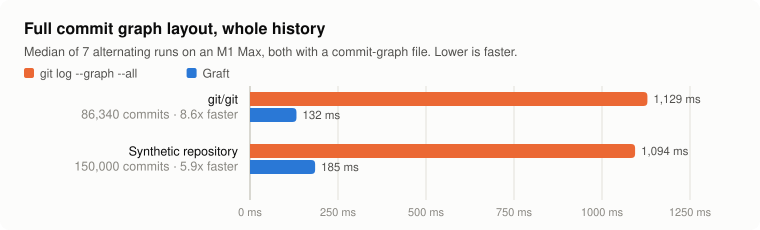
</picture>

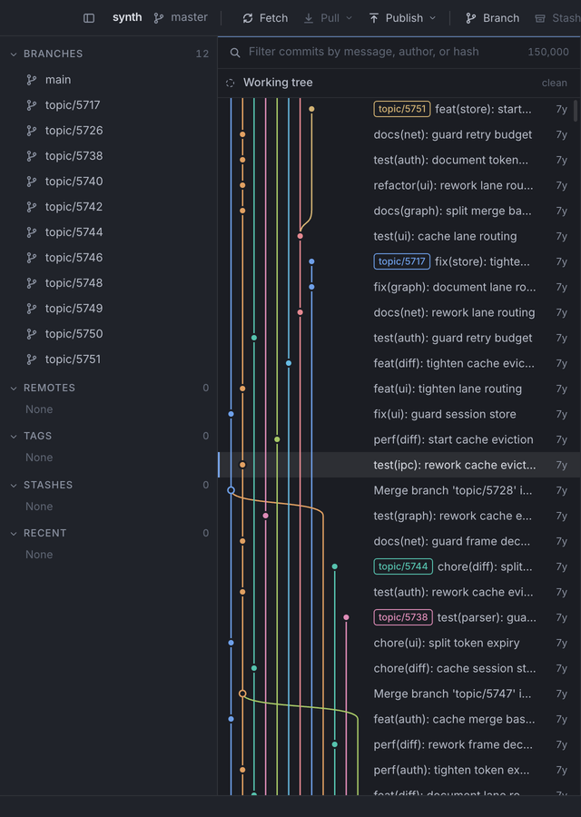

The commit graph is computed in Rust and streamed to the window in binary chunks of 2,048 rows, so the first rows appear in about 4 ms and the window is usable while the rest of the history loads. It is drawn on a single canvas that only paints the rows on screen, so scrolling costs the same with 100 commits or 150,000.

| Repository | Commits | First rows | Full history |
| --- | ---: | ---: | ---: |
| git/git | 86,340 | 4.2 ms | 132 ms |
| synthetic, 5,740 merges | 150,000 | 3.5 ms | 185 ms |

Searching the messages and authors of all 150,000 commits takes 1.4 ms.

| Structural diff on ripgrep | Commits | Source parsed | Median | p95 |
| --- | ---: | ---: | ---: | ---: |
| every non-merge commit | 2,173 | 220.5 MB | 0.36 ms | 15.3 ms |

<br clear="right">

<details>
<summary>How these were measured</summary>

Apple M1 Max (10 cores, 64 GB), macOS 27, release build, repositories with a commit-graph file. The `git log --graph --all` comparison alternates the two commands seven times and reports the medians; git writes its output to `/dev/null`. Without a commit-graph file Graft needs 461 ms for git/git, because decompressing commit objects becomes the bottleneck. The slowest single diff in the ripgrep run took 70 ms (40 files, 2.4 MB of source). Frame paint was measured in Chromium against the same frontend code; the macOS webview may cap the refresh rate at 60 Hz.

```bash
cargo run --release --example ingest -- <repository>              # graph layout
cargo run --release --example history -- <repository> <commits>   # diff speed and lines to review
```

</details>

## How it works

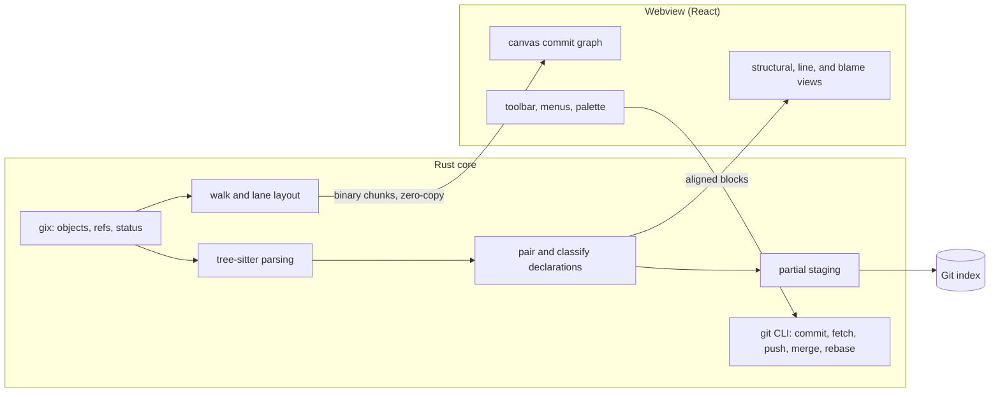

**Reading** goes through [gix](https://github.com/GitoxideLabs/gitoxide) in-process. **Writing** (commits, staging, remotes, merges) goes through the user's own `git` binary, so hooks, signing, credential helpers, and SSH settings behave exactly as on the command line.

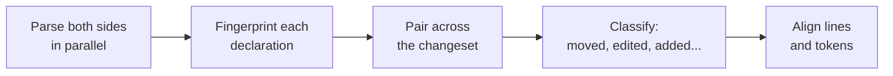

<details>
<summary>The structural diff, step by step</summary>

1. **Parse.** Both sides of every file are parsed in parallel with tree-sitter. One iterative walk produces tokens (syntax class, grammar symbol, depth) and declarations, including nesting: methods belong to their class or impl block.
2. **Fingerprint.** A declaration's hash covers the symbol, relative depth, and text of every token except comments, so whitespace and comment edits do not count. Signature and body are hashed separately.
3. **Pair.** Four passes, strongest evidence first: same file and name; identical hash anywhere in the changeset; same name elsewhere with at least 40% token overlap; body similarity of at least 60% for renames. A shared-token count bounds similarity, so unrelated candidates are rejected without running a diff.
4. **Classify.** A pair has moved if it changed file or container, or fell out of the longest run of siblings that kept their order. That rule is why a function pushed down by new code above it is not reported as moved.
5. **Align.** Each change becomes a block of rows aligned with Myers' algorithm, with a second pass over the tokens of changed lines.

</details>

<details>
<summary>The commit graph and its binary format</summary>

Commits are walked newest first from a priority queue, and each commit is decoded once. With a commit-graph file, topology comes from the memory map, and authors and summaries are decoded on all cores while lanes are assigned. A lane is reserved for the parent a child is waiting on, which keeps first-parent chains straight.

Every chunk is 4-byte aligned, so the webview reads it through `Uint32Array` views without copying:

| Section | Size | Content |
| --- | --- | --- |
| header | 12 x u32 | magic, first row, counts, flags, lane count, elapsed time |
| rows | 2 x u32 per row | lane, color, parent count; commit time |
| string ends | 2 x u32 per row | offsets of summary and author |
| edges | 2 x u32 per edge | bucketed by the row they end on |
| open edges | 2 x u32 per edge | edges still open at the end of the chunk |
| ref marks | 2 x u32 per mark | row and ref index |
| oids | 20 bytes per row | commit ids |
| strings | bytes | UTF-8 text, decoded only for visible rows |

Because edges are bucketed and each chunk carries its open edges, painting any window of rows touches at most one chunk of data.

</details>

<details>
<summary>Partial staging</summary>

**By function.** Graft diffs the staged version of the file against the working copy, finds the selected declaration, and rewrites only that span of the staged text. A new or moved declaration is inserted after the nearest sibling both versions share. One test stages every declaration of a file one by one and checks that the result is byte-identical to the working copy.

**By hunk or line.** The line diff compares lines exactly, as `git diff` does. Staging rebuilds the file from that alignment, keeping only the selected changes. Line endings and a missing final newline are preserved, and a selection that no longer matches the file is rejected instead of being applied to the wrong lines.

</details>

<details>
<summary>Project layout</summary>

```
src-tauri/src/
  git/         repository reads (gix), graph layout, binary format, search,
               status, blame, and git CLI commands (sync, merge, stash, branches)
  ast_diff/    parsing, fingerprinting, pairing, classification, alignment,
               and partial staging
  ai/          offline risk rules and commit drafting, optional model client
  commands/    the IPC surface exposed to the webview
src-tauri/tests/   58 integration tests, run against a scripted repository
                   with its own offline remote
src/
  components/  graph canvas, diff views, inspector, menus, palette
  store/       Zustand stores
  lib/         IPC bindings, graph model over the binary chunks, actions
```

No source file is longer than 220 lines, and `cargo clippy` reports no warnings.

</details>

## Getting started

Requirements: Rust (stable), Node.js 22+, Git 2.30+, and the [Tauri system dependencies](https://v2.tauri.app/start/prerequisites/).

```bash
npm install
npm run tauri dev                  # run in development
npm run install:mac                # build Graft.app and copy it to /Applications
npm run tauri build                # build installers for the current platform
cd src-tauri && cargo test         # run the test suite
```

Open a repository with `Cmd+O`, by dropping its folder on the window, or with `npx tauri dev -- -- /path/to/repository`.

<details>
<summary>Keyboard shortcuts</summary>

| Key | Action |
| --- | --- |
| `Cmd+K` | Command palette |
| `Cmd+O` | Open a repository |
| `Cmd+B` | Toggle the sidebar |
| `J` / `K` | Next / previous commit, or change when the diff has focus |
| `H` / `L` | Focus the graph / the diff |
| `Space` | Stage or unstage the active function, hunk, or file |
| `Tab` | Switch between the structural and line diff |
| `B` | Toggle blame |
| `/` | Filter commits |
| `C` | Write a commit message |
| `Cmd+Enter` | Commit |
| `Cmd+Shift+R` | Run the risk audit |
| `Esc` | Close a menu or dialog, or leave file history |

Commits, branches, tags, stashes, and files have context menus. In the line diff, click a line number to pick a line, Shift-click to extend, and double-click to pick a whole block.

</details>

<details>
<summary>Optional AI provider</summary>

Without configuration, commit drafts and risk findings come from built-in rules and nothing leaves your machine. To add a model, use **Configure AI Provider** in the palette, or set:

| Variable | Meaning |
| --- | --- |
| `GRAFT_AI_PROVIDER` | `anthropic`, `openai`, or `ollama` |
| `GRAFT_AI_MODEL` | Model name; defaults to `claude-opus-5-5` for Anthropic |
| `GRAFT_AI_BASE_URL` | Custom endpoint, for proxies and OpenAI-compatible servers |
| `GRAFT_AI_API_KEY` | API key; `ANTHROPIC_API_KEY` and `OPENAI_API_KEY` also work |

Only a structural summary is sent (one line per changed declaration and the lines that differ), never unchanged code. If a request fails, Graft falls back to the built-in rules and says why.

</details>

## Limitations

- No interactive rebase, three-way merge editor, submodule or worktree management, or remote editing.
- Network commands show no progress and cannot answer password prompts; authentication must go through a credential helper or an SSH agent.
- Hunks and lines are staged from the line diff only.
- Binary files and files over 1 MB are listed but not diffed; a changeset is analyzed up to 400 files.
- SHA-256 repositories are not supported.

## License

[MIT](LICENSE) © 2026 Geoffrey Heckmann
